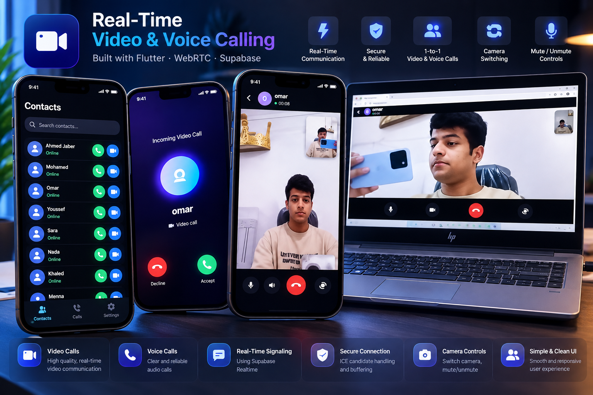

<div align="center">

# 📞 Real-Time Voice & Video Calling App

### Flutter • WebRTC • Supabase Realtime • BLoC/Cubit

A real-time peer-to-peer voice and video calling
application built with Flutter, WebRTC, and Supabase.

Supports live communication between devices,
real-time signaling, call state management,
and essential audio/video controls.


</div>

---

## 📸 Project Preview

<div align="center">

<a href="de68366d-696f-4a61-82e8-734178d4c4e8.png">
  
</a>

</div>

---

## 📖 About the Project

This project is a real-time voice and video calling
application developed using Flutter and WebRTC.

It demonstrates peer-to-peer communication
between devices using WebRTC, with Supabase
Realtime handling the signaling process.

Unlike a basic WebRTC demonstration, this
application implements a complete calling flow,
including ringing, connection establishment,
media controls, and call termination.

The application was tested with real calls
between two devices.

---

## ✨ Key Features

### 📹 Video Calling
- Real-time peer-to-peer video communication.
- Live camera streaming.
- Switch between front and rear cameras.
- Enable or disable video during calls.

### 🎤 Voice Calling
- Real-time audio communication.
- Microphone mute and unmute.
- Speaker control.
- Audio stream management.

### 📞 Call Management
- Initiate outgoing calls.
- Handle incoming calls.
- Ringing and connection states.
- End active calls.
- Manage call lifecycle.

### 🔄 Real-Time Signaling
- Supabase Realtime signaling.
- SDP offer and answer exchange.
- Live ICE candidate exchange.
- PostgreSQL Changes subscriptions.
- No separate signaling server required.

### 🔐 Authentication
- Supabase Authentication.
- Anonymous authentication for testing.
- User session management.

### 🧠 State Management
- BLoC/Cubit architecture.
- Reactive call state updates.
- Separation of UI and business logic.
- Structured call lifecycle handling.

---

## 🛠️ Technologies Used

| Technology | Purpose |
|------------|---------|
| Flutter | Cross-platform UI |
| Dart | Application logic |
| WebRTC | Peer-to-peer media |
| Supabase | Backend services |
| Supabase Realtime | Signaling |
| PostgreSQL | Call signaling data |
| BLoC/Cubit | State management |
| Supabase Auth | Authentication |
| Git & GitHub | Version control |

---

## 🏗️ System Architecture

The application uses WebRTC for peer-to-peer
audio and video communication.

Supabase Realtime acts as the signaling
mechanism for establishing connections.

```text
          Flutter Device A
                 |
                 |
          Supabase Realtime
           Signaling Layer
                 |
                 |
          Flutter Device B


      WebRTC Peer Connection

   Device A <============> Device B

        Audio / Video
```

### Signaling Flow

```text
Caller                     Receiver
  |                            |
  |------ Create Call -------->|
  |                            |
  |------ SDP Offer ---------->|
  |                            |
  |<----- SDP Answer ----------|
  |                            |
  |<---- ICE Candidates ------>|
  |                            |
  |===== WebRTC Connected =====|
  |                            |
  |<==== Audio / Video =======>|
  |                            |
  |------ End Call ----------->|
```

---

## 📱 Call Lifecycle

The application manages calls through
the following states:

```text
Idle
  |
  v
Ringing
  |
  v
Connecting
  |
  v
Connected
  |
  v
Ended
```

BLoC/Cubit handles transitions between
states and updates the UI accordingly.

---

## 🧩 Technical Challenges

### ICE Candidate Race Conditions

One of the main technical challenges was
handling ICE candidates arriving before
the corresponding call record was available
in the database.

This could result in lost candidates
and failed peer connections.

### Solution

Implemented candidate buffering to manage
early ICE candidates.

The application processes buffered candidates
when the required signaling information
becomes available.

This improves connection reliability
and prevents signaling race conditions.

---

## 🚀 Getting Started

### Prerequisites

Make sure you have:

- Flutter SDK
- Dart SDK
- Android Studio or VS Code
- Git
- Supabase project
- Two devices for call testing

### 1. Clone the Repository

```bash
git clone https://github.com/AhmedJaberAhmed/callapp.git
```

### 2. Open the Project

```bash
cd callapp
```

### 3. Install Dependencies

```bash
flutter pub get
```

### 4. Configure Supabase

Create a Supabase project.

Configure the Flutter application with:

- Supabase Project URL
- Supabase Publishable/Anon Key
- Required database tables
- Realtime subscriptions
- Row Level Security policies
- Authentication settings

Enable anonymous authentication if
using the project's anonymous login flow.

Do not expose a Supabase service-role
key in the client application.

### 5. Configure Device Permissions

Ensure the application has the required
camera and microphone permissions.

For Android, verify the permissions
in AndroidManifest.xml.

For iOS, verify camera and microphone
usage descriptions in Info.plist.

### 6. Run the Application

```bash
flutter run
```

### 7. Test Calling

Run the application on two devices.

Establish a call between them and test:

- Video communication
- Audio communication
- Microphone controls
- Camera switching
- Speaker controls
- Call termination

Note: Successful calling requires the
correct Supabase signaling schema and
network connectivity.

Some networks may require a TURN server
for reliable WebRTC connectivity.

---

## 💡 What I Learned

Building this application provided
hands-on experience with:

- WebRTC peer-to-peer communication.
- SDP offer/answer negotiation.
- ICE candidate exchange.
- Supabase Realtime subscriptions.
- Asynchronous event handling.
- Race condition debugging.
- Call lifecycle state management.
- Real-time application architecture.

---

## 🎯 Project Goals

- Build a real peer-to-peer calling system.
- Implement signaling without a dedicated
  signaling server.
- Manage complex real-time call states.
- Improve reliability of ICE exchange.
- Deliver a responsive Flutter interface.

---

## 👨‍💻 Developer

**Ahmed Jaber Ahmed**

Flutter Developer | Mobile App Developer

Computer Science & Artificial Intelligence Graduate

📍 Cairo, Egypt

- GitHub: [AhmedJaberAhmed](https://github.com/AhmedJaberAhmed)
- Portfolio: [My Portfolio](https://ahmedjaberahmed.github.io/Jaber-website/)
- LinkedIn: [Ahmed Jaber Ahmed](https://www.linkedin.com/in/ahmedjaberahmed/)

---

<div align="center">

### ⭐ Support the Project

If you find this project interesting,
consider giving it a star!

**Built with Flutter 💙**

</div>
